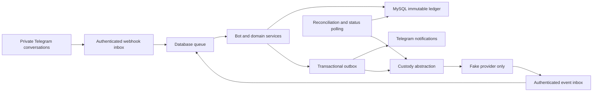

# Telegram cryptocurrency wallet bot

Executable **Laravel 13 / PHP / MySQL 8.4 sandbox**, operated through private Telegram bot conversations. It includes an immutable double-entry ledger, persistent bot state, durable jobs, fake custody, fee settlement controls and automated failure tests.

**Real customer assets: NO-GO.** The fake adapter owns no blockchain addresses or keys and never sends ETH. Do not fund displayed addresses on any network. Live mode and unsupported adapters fail closed. No real custody provider or independent security/custody/legal approval is represented by this build.

## 1. Executive architecture recommendation

Use a modular monolith with provider-managed custody, native ETH only, unique deposit addresses, off-chain internal transfers, atomically reserved asynchronous withdrawals and batch owner fee settlements. The executable reference uses a **simulated** `ethereum-sepolia` network; actual custody selection is deferred pending due diligence. There are no Mini Apps, websites, dashboards, SPAs or public customer APIs.



Decision/risk review: [docs/review.md](docs/review.md). The key risks are custody compromise, Telegram account takeover, duplicate external payments and unsupported regulatory operation.

## 2. Assumptions, tradeoffs and unresolved issues

Native ETH avoids token issuer/contract and separate gas-asset handling. Unique addresses simplify attribution. Internal transfers avoid chain fees. Provider signing avoids keys on the bot host. Batch settlement avoids claiming every earned fee is immediately forwarded on-chain. These decisions and alternatives are assessed in the [assumptions register](docs/review.md).

Operator/customer jurisdictions, custody entity/product, actual finality, compliance feasibility, real failure-cost semantics and production recovery approvals remain unresolved. A Telegram account is not a verified legal identity. The sandbox uses a simulated 12-confirmation policy; real Ethereum consensus finality is unimplemented.

## 3. Expert roles and responsibilities

The [12 specialist perspectives and concrete challenges](docs/review.md) cover product, architecture, Laravel, financial ledger, custody, Telegram UX, security, compliance/privacy, QA, SRE, reconciliation and support. Three parallel implementation/review agents plus the coordinating agent applied those perspectives. They do not constitute twelve independent humans or external approvals.

## 4. Risk register and mitigation plan

The [critical-risk matrix](docs/review.md) and [threat model](docs/security.md) tie risks to controls and remaining launch gates: immutable event identity, guarded state transitions, numeric sender authentication, callback ownership/expiry, private-chat restriction, exact arithmetic, reserve-before-submit, original provider-ID lookup, least privilege, audit, reconciliation and pauses. Telegram takeover, privileged database access and live custody/legal suitability require independent assessment.

## 5. MVP and deferred features

Implemented sandbox flows: onboarding, balances, receive/copy address, internal send, external withdrawal preview/confirm, transaction/deposit history/details, terms/privacy/fees/limits, support, admin roles/reviews/alerts/holds/freezes/pauses/reconciliation, and dual-approved delayed batch fee settlement.

Deferred: real blockchain/custody adapter; real KYC/sanctions/Travel Rule services; account takeover recovery; automated recovery of charged failures/reincluded deposits; runtime fee/limit mutation and payout-destination changes; production alert routing, HA and independently exercised disaster recovery. Fees/limits are versioned reviewed configuration and visible in Telegram. Optional username lookup is omitted; users select stable wallet codes. Trading, fiat, staking, lending, multi-asset support and web interfaces are excluded.

## 6. Telegram user and admin UX specification

[Exact texts, buttons, validation and recovery paths](docs/telegram-ux.md) describe the executable screens. Start with `/start`, accept the sandbox eligibility/risk/terms disclosure, then `/menu`. `/admin` is limited to configured numeric Telegram IDs and per-action Owner, Operations, Compliance, Finance or Support roles. Backend infrastructure commands do not provide a second customer interface.

## 7. MySQL ERD, tables, migrations and constraints

[ERD and schema](docs/ledger.md) accompany executable [migrations](database/migrations). MySQL uses `DECIMAL(65,0)` for base units, InnoDB, foreign keys, unique Telegram IDs/wallet codes/addresses, unique chain events, quote-to-transfer uniqueness, idempotency references and posting constraints. SQLite uses text columns solely to preserve exact test values. Journals, postings and audit rows reject updates/deletes at the database boundary; production requires separate runtime/migration roles.

## 8. Financial ledger and journal design

[Accounting examples and invariants](docs/ledger.md) cover custody assets, negative customer liabilities, available/reserved/held buckets, pending deposits, service revenue, network expense/recovery, reversals and owner distributions. Balances derive from immutable postings, never an editable customer balance column. BCMath processes integer strings; percentage fees round upward to a base unit. Balanced journals alone do not establish backing, so independent custody reconciliation is mandatory.

## 9. Transaction states and failure-recovery rules

[State guards](docs/ledger.md): withdrawals move `reserved → submitting → broadcast → completed`, with `unknown`, `failed` and `manual_review` paths. Once submission is claimed, retries query the original provider ID; they never send a second payment. Free terminal failures refund once; uncertain/charged failures retain reservations. Deposits credit once after simulated confirmation and append a reversal on reorganization. Immutable history remains intact. Manual resolution of certain exceptional states is deliberately a live launch blocker.

## 10. Custody-provider integration and fee architecture

The [custody contract](docs/custody.md) specifies address allocation, quotes, submission, original-ID status, independent balances, signed fake events and finality requirements. [Verified candidate research](docs/review.md) does not select or approve a provider. Service-fee revenue is separate from network costs. Batch settlements use platform equity only, a recent clean reconciliation, an approved external destination, two different authorized actors and at least a 24-hour delay.

## 11. Full Laravel implementation in dependency order

1. [Configuration](config/wallet.php), [environment template](.env.example), migrations and read models under `app/Domain/Models`.
2. [Exact amounts](app/Domain/Amount.php), [fee policy](app/Domain/FeePolicy.php), [ledger](app/Domain/Ledger.php).
3. [Provider interface](app/Custody/CustodyProvider.php) and [persistent fake adapter](app/Custody/FakeCustodyProvider.php).
4. [Wallet service](app/Domain/WalletService.php), [deposits](app/Domain/DepositService.php), [withdrawals](app/Domain/WithdrawalService.php), [reconciliation](app/Domain/ReconciliationService.php), [settlement](app/Finance/FeeSettlementService.php).
5. [Telegram bot](app/Telegram/Bot.php), permissions, persistent callbacks/conversations, [webhook controllers](app/Http/Controllers), and [queue jobs](app/Jobs).
6. [Outbox delivery](app/Jobs/DeliverOutbox.php), [scheduled recovery/polling](routes/console.php), deployment assets and tests.

Quick verification with installed PHP/Composer:

```sh
composer install
cp .env.example .env
php artisan key:generate
# Configure MySQL and sandbox-only bot secrets in .env.
php artisan migrate --force
php artisan test
php artisan wallet:reconcile
php artisan queue:work --sleep=1 --tries=5 --timeout=45
# Run php artisan schedule:work in another supervised process.
```

Only `POST /webhooks/telegram` and `POST /webhooks/custody` are routed. TLS/webhook registration instructions and Docker deployment are in [operations.md](docs/operations.md). No credentials or external deployment have been provisioned.

## 12. Automated tests with expected results

[Acceptance matrix and execution evidence](docs/acceptance.md) distinguish executed tests from pending checks. Tests cover exact arithmetic, duplicates, stale authorization, insufficient funds, holds, reorgs, fake outages/unknown outcomes, fee changes, notification failure, usernames, webhook forgery, admin permissions, fee settlement and reconciliation discrepancies. Actual MySQL tests run 20 separate processes behind a barrier and restore a real SQL backup before replaying authenticated events.

```sh
php artisan test
# Isolated MySQL 8.4 test instance required; never target a customer database.
sh ops/test-mysql.sh
vendor/bin/pint --test
composer validate --strict
composer audit --locked
```

## 13. Secure deployment and operations runbook

[Deployment, worker/scheduler supervision, backups/restores, reconciliation, key rotation, incident response and support](docs/operations.md). Container assets are [Dockerfile](Dockerfile), [compose.yaml](compose.yaml) and [callback-only Nginx configuration](ops/nginx.conf). They are supplied for sandbox use; TLS ingress and secrets are operator-provided. Configuration, permissions, infrastructure and real provider chaos tests must be reviewed independently before deployment with customer assets.

## 14. Explicit production go/no-go checklist

**NO-GO for real assets.** [The checklist](docs/production-checklist.md) requires evidence and human sign-off from independent Security, Custody, Legal/Compliance, Finance, Operations and Owner reviewers for the exact release/configuration. It includes jurisdiction/licensing/AML/KYC/sanctions/Travel Rule/privacy decisions, verified real integration, production finality/reconciliation, account recovery, secret management, monitoring, backup/PITR and incident exercises. Passing fake-provider tests satisfies no legal or custody approval.

Each phase's decisions, risks, artifacts, remaining tests and launch blockers are tracked in the [phase disposition](docs/review.md) and [acceptance matrix](docs/acceptance.md).
