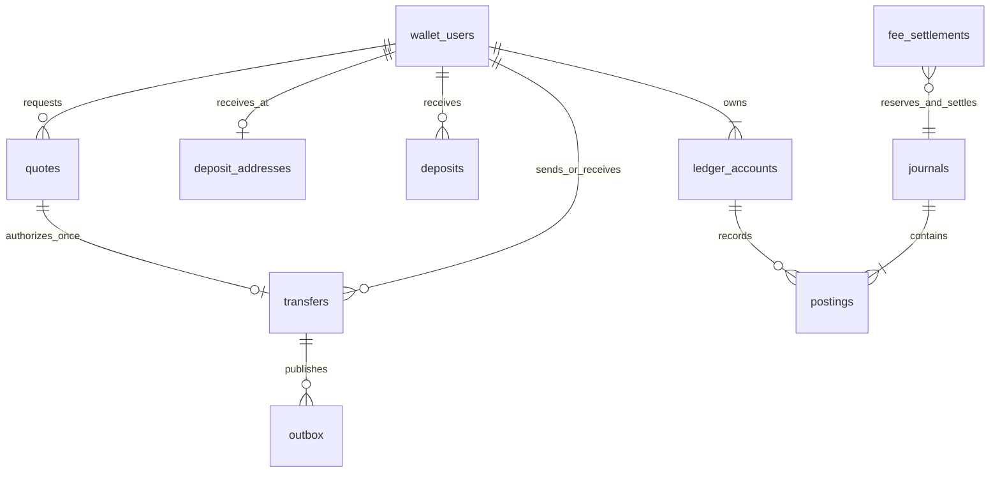
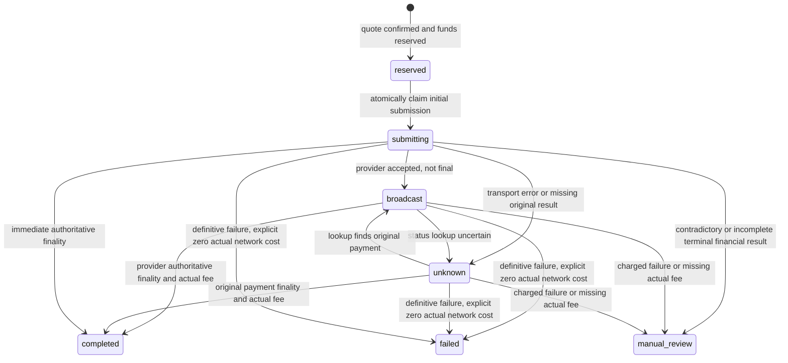

# Ledger and financial state contract

This is an executable sandbox for native ETH (18 decimal places) on the Ethereum Sepolia accounting scope. The fake provider simulates balances and finality in SQL; it allocates synthetic addresses and never talks to Ethereum. No customer assets, private keys, recovery phrases, mainnet or live custody support are present. MySQL 8.4/InnoDB is the financial target. The full core `LedgerTest` feature suite was also run successfully against MySQL 8.4 (18 tests, 96 assertions before the final asset-scope regression test). SQLite is a local/test convenience, not the concurrency authority.

## Schema and ownership

The domain migration creates these tables:

| Table | Purpose and constraints |
|---|---|
| `wallet_users` | Immutable numeric Telegram identity stored as a string, unique `telegram_id` and randomly generated stable `wallet_code`; mutable username is display-only and never authenticates. Acceptance version/time and account freeze. |
| `ledger_accounts` | Unique account code, ETH only, optional customer foreign key. No editable cached balance. Three liability buckets per customer; system custody, revenue, network expense and network recovery accounts. Finance adds fee payable. |
| `journals` | UUID primary key; unique semantic reference; kind, JSON metadata and timestamp. |
| `postings` | Exact signed amount, journal/account foreign keys; unique `(journal_id,account_id)`; indexed account/id traversal. Journal and account deletion restricted. |
| `quotes` | UUID, authenticated user, immutable recipient/destination/amount/fee/total/policy snapshot, expiration and consumption time. |
| `transfers` | UUID; unique quote foreign key; explicit status; authorized network maximum remains `network_fee`, separately recorded `actual_network_fee`; unique provider reference. Sender/time and status indexes. |
| `deposit_addresses` | Unique customer and unique assigned address. One provider-assigned address per customer. |
| `deposits` | Unique `(network,txid,event_index)`, immutable financial event identity, normalized lowercase EVM address/transaction hash, amount, confirmation/finality/reorg state. Unknown addresses are quarantined without customer credit. |
| `outbox` | Unique optional deduplication key; type, JSON payload, availability, attempts and delivered time. Funds and financial outbox events commit atomically. |
| `controls` | Durable global transfer and withdrawal pauses. Missing controls fail closed. |
| `audit_logs` | Append-only actor, action, subject, metadata and timestamp. Never store secrets or raw provider credentials. |
| `reconciliations` | Immutable-by-convention snapshots of provider custody, ledger custody, aggregate customer liabilities, fee revenue and match result. A discrepancy durably pauses transfers. |

Finance, Telegram and integration migrations add fee settlements, callback tokens, conversation state, support tickets, provider-event inbox, processed Telegram updates and fake provider simulation state. `App\Domain\Models` contains read projections; instance saving/deleting is rejected. Services use query-builder writes inside explicit transactions. MySQL and SQLite database triggers forbid journal/posting/audit updates and deletes, including raw SQL. Triggers do not protect against a privileged DBA dropping the triggers; production requires restricted database credentials and external append-only audit retention. Journal balancing is enforced by `Ledger::post` and reconciled; direct privileged INSERTs can violate it and are outside the application trust boundary.

## Exact numeric rules

All financial APIs accept integer base units as strings. PHP BCMath uses explicit scale zero. `Amount::parse` converts human ETH decimal text (maximum 18 fraction digits) exactly; `Amount::format` reverses this. No float, exponent, signed input, implicit rounding of user amounts, or leading-zero base-unit representation is accepted. Input amounts are bounded to 60 digits and signed postings to 64, below MySQL `DECIMAL(65,0)` capacity. SQLite stores TEXT; SQL `SUM` is deliberately avoided because SQLite can coerce large amounts to floating point. Ledger balances are ordered streaming additions through BCMath.

Percentage fees round **up** to the next wei, then apply configured minimum/maximum. `service_fee = clamp(fixed + ceil(amount*bps/10000), min, max)`; bps must be 0..10000 and the range must be coherent. Policies have explicit versions. A quote records its version and disclosed charges; changing the current version invalidates outstanding unconsumed quotes. Operational changes must increment the policy version. A quote never silently changes its amount, destination or fees.

## Sign convention and journals

Positive is debit; negative is credit. Actual custody assets are positive. Customer available/reserved/held liabilities, earned service revenue and network cost recoveries are negative. Costs are positive. Balance displays negate the corresponding liability account. A positive available-account ledger balance after a reorg is a customer receivable, displayed as a negative wallet balance; it freezes the wallet and must never reduce the amount reported as owed to other customers.

Examples below use integer wei for readability. A customer deposits 1,000; sends 100 internally for a 10 service fee; or withdraws 100 with a 10 service fee and authorized network maximum 5.

| Event | Debit / positive | Credit / negative |
|---|---|---|
| Deposit below finality | None (pending event only) | None |
| Final deposit | Custody +1,000 | Customer available -1,000 |
| Internal transfer | Sender available +110 | Recipient available -100; revenue -10 |
| Reserve withdrawal | Available +115 | Reserved -115 |
| Withdrawal succeeds, actual network 3 | Reserved +115; network expense +3 | Custody -103; revenue -10; network recovery -3; available -2 (unused maximum refund) |
| Provider definitively fails with zero chain charge | Reserved +115 | Available -115 |
| Place hold | Available +100 | Held -100 |
| Release hold | Held +100 | Available -100 |
| Deposit reorg compensation | Original customer available +1,000 | Custody -1,000 |
| Fee settlement reserves amount 50 plus maximum fee 5 | Revenue +55 | Fee payable -55 |
| Fee settlement completes with actual fee 3 | Fee payable +55; network expense +3 | Custody -53; revenue -5 |
| Fee settlement definitively fails with zero chain charge | Fee payable +55 | Revenue -55 |

Each row sums to zero. Network cost/recovery is separate from platform service revenue. If a successful customer withdrawal costs more than its authorized maximum, the customer pays at most that maximum, the platform absorbs the excess as expense, and withdrawals pause. A real provider must enforce the submitted maximum; the simulator can inject overruns to test accounting. Service revenue is earned only on a completed internal transfer or final external withdrawal, never at reserve/submission time. Fee payable is platform equity, separate from customer liabilities. The Finance settlement service checks net platform revenue after costs, customer backing, fresh reconciliation, no unresolved external payments, approved destination, independent Owner approval and a minimum 24-hour delay.

## Locking, idempotency and state transitions

Financial write transactions first lock durable control rows in key order. This intentionally serializes financial mutations across the small MVP and closes races across reconciliation, freeze/pause operations, deposits, settlements and customer transfers. User rows lock in ascending id order when multiple customers are involved; ledger account rows lock in lexical code order. InnoDB and Laravel use bounded three-attempt deadlock retry. This simple lock regime trades throughput for auditable correctness. Provider calls occur outside these critical sections; the bot queues quote/address/reconciliation work to avoid external HTTP inside Telegram inbox transactions.

A journal reference can be replayed only with the same kind/account/amount intent; conflicting reuse throws. Replayed metadata does not rewrite the original audit/history. Deposit event uniqueness, transfer quote uniqueness, durable inbox/outbox keys and permanent provider idempotency are independent layers. Confirm locks the quote, checks ownership, expiry, fee policy, account acceptance/freeze, pauses, latest known reconciliation failure, current spendable funds and daily authorized deduction limits. Two clicks return the same existing transfer, including after quote expiry. All customer amounts and fees move to reserved before external submission. Held and reserved funds cannot fund another transfer. Daily limits count authorized total including fees and pending/uncertain payments; failed/refunded payments do not count. Daily windows use server UTC.

External withdrawal transitions:

A worker crash after `submitting` can only result in lookup of the original UUID idempotency key. It never sends again. Provider authoritative absence after such a crash remains unknown with reserved funds; there is deliberately no automatic retry/refund for that state. Resolving it requires an independently reviewed provider investigation and an explicitly designed recovery command; that command is not implemented. Failed on-chain transactions with nonzero or omitted actual network costs enter manual review, retain reserves, pause withdrawals, and require reviewed failure-cost accounting. The fake provider represents a definitive failed submission as zero actual network charge. Completed/failed/manual-review states cannot automatically regress. A reserve blocked by pause/freeze stays reserved for later scheduled processing. The simulator's `confirmed` result stands for provider finality; no live chain verification is claimed.

Deposits remain pending until the configured 12 confirmations. Repeated pending/final notifications do not double credit. Canonical transaction identity cannot change amount/address/asset. An explicit removal or post-credit block-hash change creates a compensating journal, freezes the original customer and pauses all transfers. Pending removed and credited reversed events are conservative terminal tombstones. Re-inclusion/reconfirmation never silently credits them again; manual chain verification and a reviewed recovery workflow are required. There is no recovery workflow for this in the MVP. Unknown-address deposits remain quarantined for reconciliation, with no automatic owner claim.

## Reconciliation and settlement protections

`ReconciliationService::run` reads independent provider assets, then checks every journal sum and minimum posting count, compares exact ledger custody, and sums positive amounts owed across **each** customer bucket without netting customer receivables. Assets must cover total customer liabilities. Provider snapshots can race a newly finalized provider payment; any mismatch pauses transfers and requires another reconciled snapshot/operator review. No discrepancy is repaired with a balance edit, and a later clean snapshot does not silently unpause controls. Pending/unknown provider payments retain reserves and block fee settlement. This conservative approach may pause for a known in-flight reconciling item; a live system needs provider snapshot sequencing, in-flight cash accounting and operational investigation tooling.

The `earned_fees` reconciliation field is the retained revenue-account balance after distribution/reservation entries; distributable revenue additionally subtracts network expense net of recoveries. It is not a lifetime gross-fee report. Owner payout never debits a customer account. The approved destination is immutable environment configuration, there is no bot destination-change endpoint. Production destination governance (hardware-backed approvals, permission/delay policy and independent custody allowlists) remains a launch blocker.

## Automated evidence and remaining launch checks

`tests/Unit/AmountTest.php` and `tests/Feature/LedgerTest.php` cover huge exact amounts, parsing, fee ceilings/clamps, repeated registrations, username reuse, pending/final duplicate deposits and replay, internal double confirmation, stale expiry/policy, 20 conflicting previews, insufficient available and held funds, independent administrator authorization, timeout-after-submit, original-key reconciliation, provider failure/refund, fee refunds/overruns, spent-deposit reorg freeze, provider outage/absence, wrong network/address, reconciliation discrepancies, conflicting journal references and append-only SQL enforcement. The latest SQLite core run passes 23 tests/111 assertions including the Amount unit suite. The deterministic preview test supplements the independent MySQL concurrency suite: it is not itself a simultaneous test. The review agent exercised 20 separate MySQL sessions/processes behind a common start barrier and reported 77 assertions passing; see the dedicated concurrency artifact for reproducible commands.

Before real money, require an independently audited real custody adapter and authenticated provider finality, independent security/custody/legal signoff, verified MySQL constraints/backup-restore replay, chaos and crash testing at every commit/provider boundary, infrastructure recovery tests, production DB least privilege, reconciliation snapshot sequencing and investigation tools, actual failed-chain-cost resolution, reorg/re-inclusion recovery, admin manual-review resolution, asset conservation monitoring, notification delivery monitoring, and KYC/AML/sanctions/Travel Rule eligibility design. The accounting sandbox does not satisfy those launch gates by itself.
